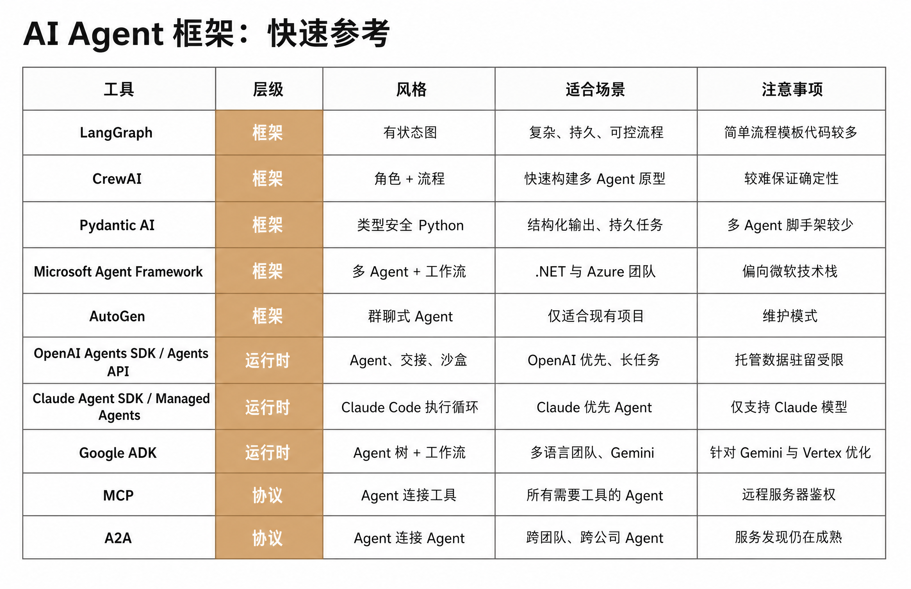
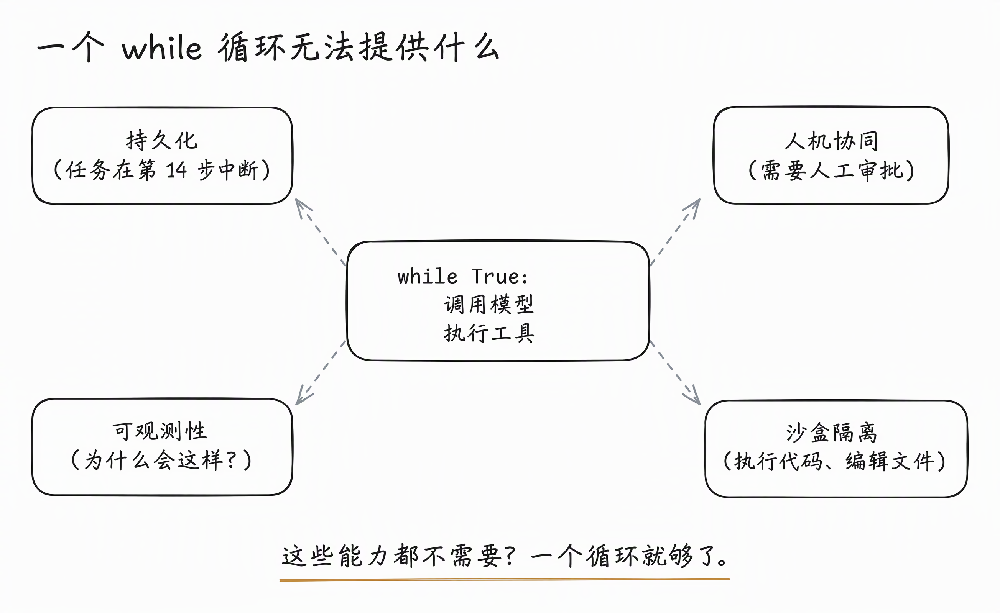
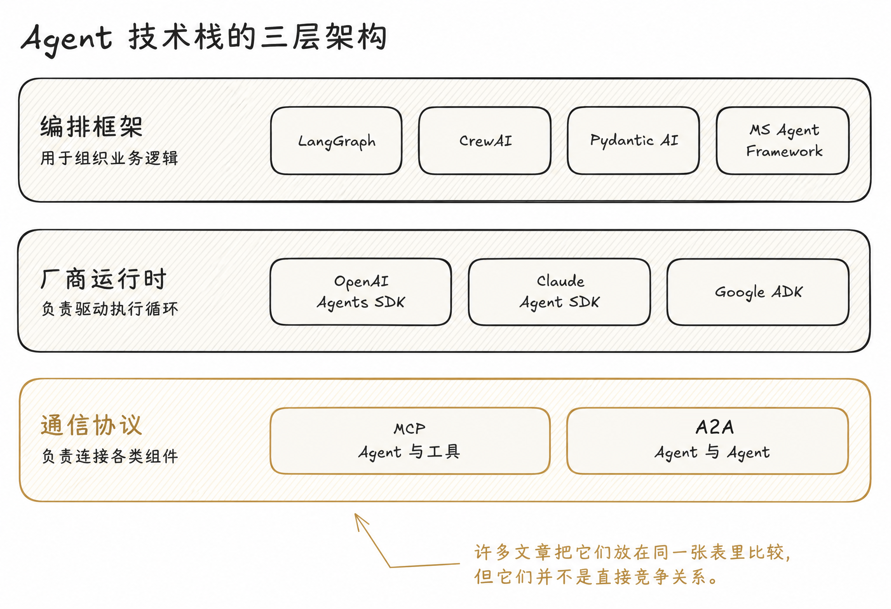
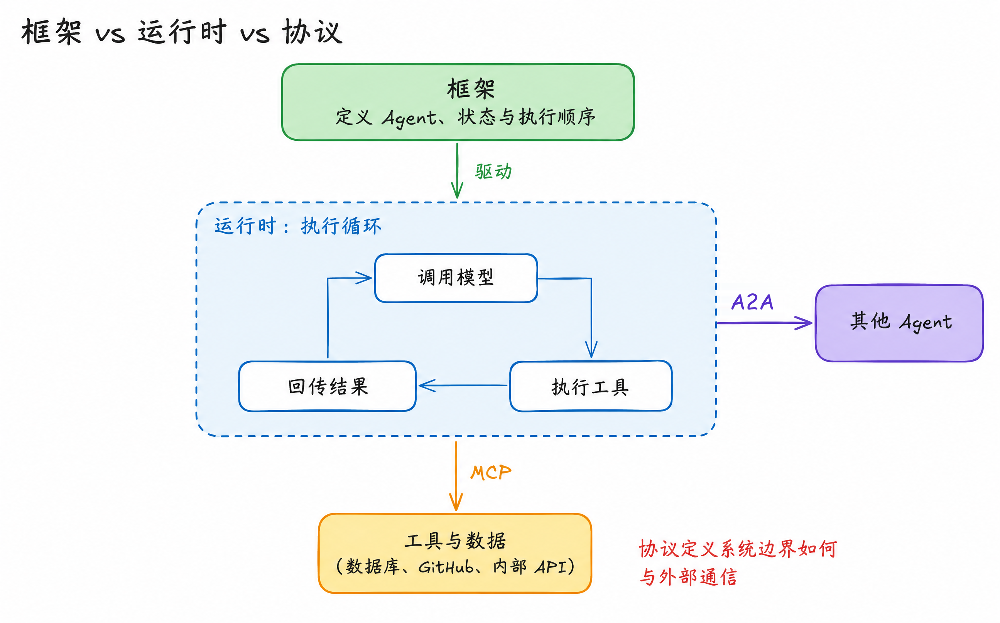
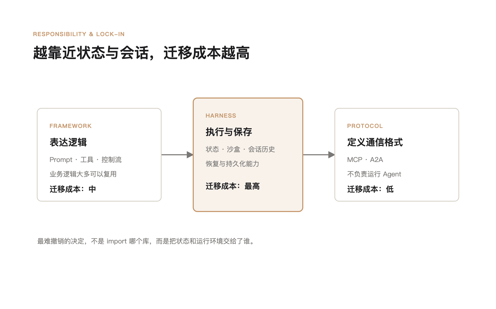
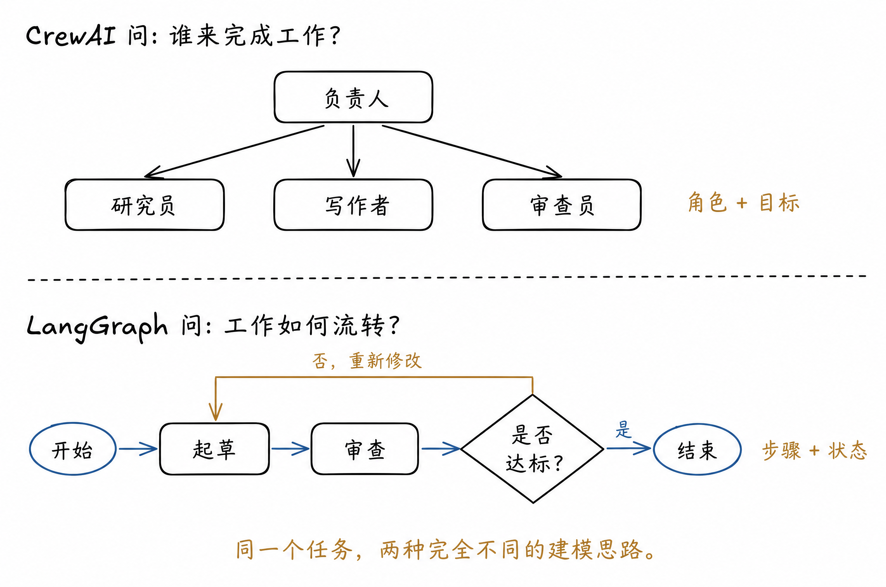
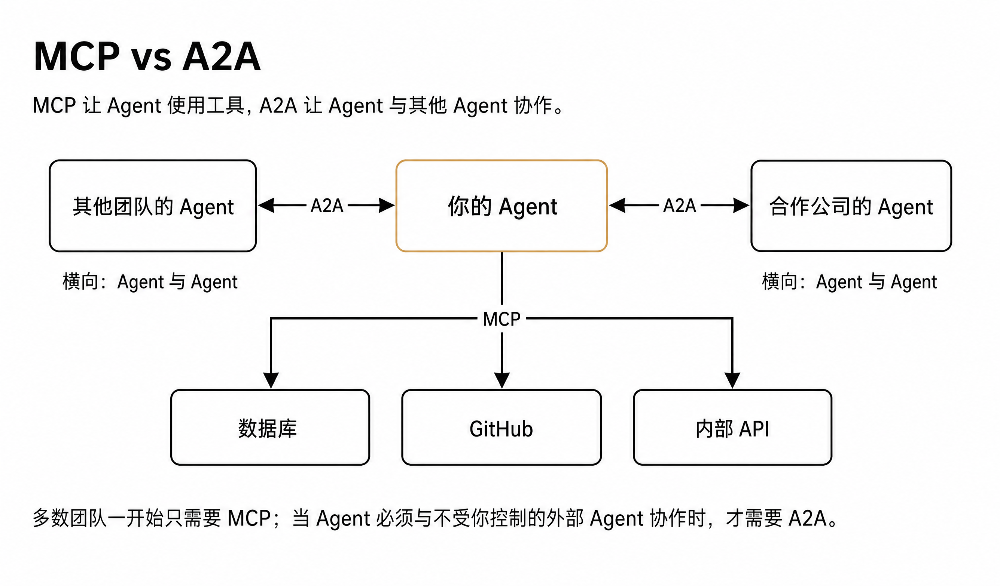
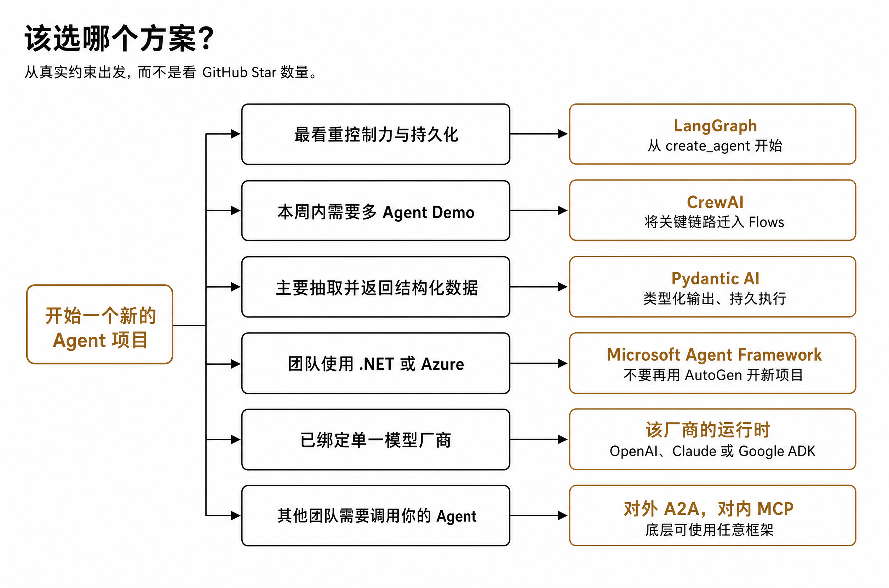
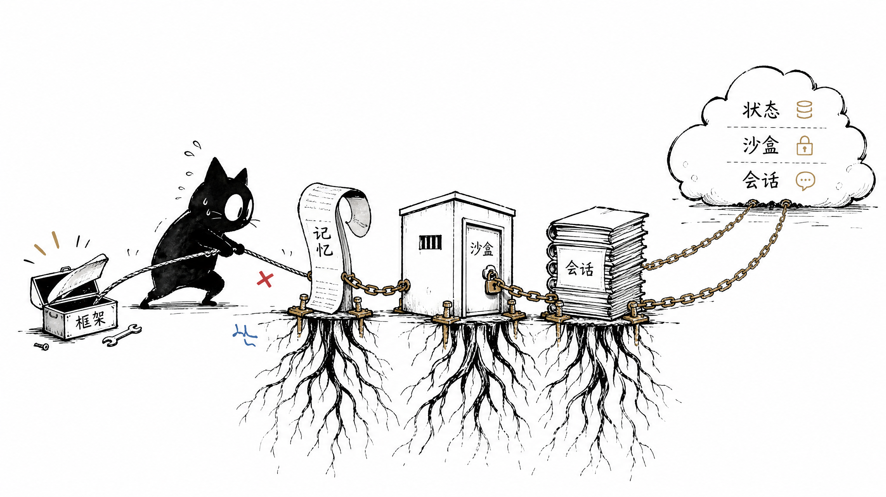

### TL;DR / 快速参考：全景横向对比



---

最近经常被问到的一个问题是：**我们到底该用哪个 Agent 框架？**

这句提问背后的真实诉求其实一直在变。有时大家是在 LangGraph 和 CrewAI 之间权衡；有时是想知道“能否直接用 OpenAI Agents SDK，完全省去额外框架”；甚至，提问者实际关心的其实是 MCP，但这根本不是一个框架。

有这种困惑很正常，过去一年里，AI 领域以一种非常特殊的方式变得格外令人眼花缭乱：各大模型实验室开始推出自己的 Agent 运行时，两大核心协议先后纳入 Linux 基金会旗下；而微软则把 GitHub 上星标最多的 Agent 框架之一 AutoGen 转入维护模式，并建议大家转向新的方案。如果对该领域的认知还停留在 2025 年，其中很大一部分可能已然过时。

因此，我尝试梳理出一份完整的全景参考：理清每个工具的底层工作机制、明确它们在技术栈中所处的实际层级、指出各自容易踩坑的边界，并说明如果由我今天开启一个新项目，我会如何选型。

### 是否真的需要 Agent 框架

每隔几个月，总有人发帖表示“根本不需要框架，Agent 本质上就是套了工具调用的 LLM 循环”。这话说得没错，前提是你还没把它真正推向生产环境。

用一个 `while` 循环做 Demo 确实足够，但一旦有真实用户接入，问题就会接踵而至：

- **任务在执行到第 14 步（共 20 步）时中断了。** 你是能从第 14 步断点续跑，还是只能推倒重来，为之前消耗的所有 Token 再次买单？
- **Agent 需要人工介入审批某项操作。** 这时执行流程必须暂停（可能持续数小时），并在后续恢复时毫发无损地保留先前的完整状态。
- **Agent 在生产环境中出现了错误决策。** 你需要快速定位究竟是哪一次工具调用、传入了什么输入参数引发了问题。
- **Agent 需要执行代码或编辑文件。** 你需要一个安全隔离的运行环境，确保它不会触碰任何不该触碰的系统资源。

持久化保障（Durability）、人机协同（Human-in-the-loop）、可观测性（Observability）与沙盒隔离（Sandboxing），如果你的 Agent 压根不需要这些能力，那么一个基础循环配合一个优秀的大模型确实完全足够，我也建议你直接跳过框架。但一旦你需要其中哪怕任何一项，自己从零手写最终往往只会造出一个更简陋、更难维护的框架雏形。



本文提到的每一个工具，本质上都是针对这四大问题给出的不同解法与技术倾向。记住这个核心视角，后面再看整个生态版图就会清晰得多。

### Agent 技术栈的三层架构

这里有一个能够化解大部分困惑的认知模型：**这些工具彼此之间并非全都是直接的竞争关系**。许多横向对比文章往往把 CrewAI、OpenAI Agents SDK 以及 A2A 强行塞进同一张表格里，仿佛开发者必须三选一。其实完全不是这样，它们分属于技术栈的不同层级：

- **编排框架（Orchestration Frameworks）**：与具体模型解耦的逻辑编排库，用于构建 Agent 的工作流逻辑。代表包括 LangGraph、CrewAI、Pydantic AI 以及 Microsoft Agent Framework。
- **厂商运行时（Vendor Harnesses）**：模型厂商官方提供的 Agent 执行循环，并且越来越多地以全托管云服务的方式交付。代表包括 OpenAI Agents SDK、Claude Agent SDK 以及 Google ADK。
- **通信协议（Protocols）**：让各组件相互通信的基础管道。例如 Agent 与工具交互的标准协议 MCP，以及 Agent 之间相互通信的协作协议 A2A。



### Agent Framework vs Agent Harness vs Agent Protocol

日常交流中大家经常混用这三个词，因此有必要先把它们的边界厘清：

- **Agent 框架（Agent Framework）**：是你引入到代码中的逻辑开发库，用于组织和构建你自己的 Agent 业务逻辑。程序的运行进程和核心循环由你自行掌控，框架为你提供外层脚手架支持：比如状态管理、控制流流转、重试机制，以及如何划分多个 Agent 并让它们互相协作与传递任务。LangGraph、CrewAI、Pydantic AI 和 Microsoft Agent Framework 都属于这一类。
- **Agent 运行时（Agent Harness）**：是真正驱动底层循环执行的运行环境。它负责调用模型、执行模型指定的工具调用、将执行结果回传给模型、管理上下文窗口，并在长达数小时甚至数天的执行周期中维持会话存活。如今各大模型厂商都推出了自家的运行时，并且越来越倾向于以托管 API 的形态直接提供给开发者：比如 OpenAI 的 Agents SDK 与 Agents API、Anthropic 的 Claude Agent SDK 与 Managed Agents，以及 Google 的 ADK。
- **Agent 通信协议（Agent Protocol）**：是两套不同软件之间达成一致的网络通信报文格式（Wire Format），让它们无需了解彼此的内部实现就能无缝协作。MCP 规范了 Agent 与外部工具之间的交互，A2A 则规范了 Agent 与其他 Agent 之间的协同通信。协议本身并不负责执行你的 Agent，它们只负责定义传输消息的具体结构。



### 它们并非互相替代的关系

拿“CrewAI 与 MCP”进行对比本身就属于范畴谬误，这有点像在纠结“开发网站究竟该选 Django 还是 HTTP”。

绝大多数生产级系统最终都会各取其一并组合使用：用一套**框架**来组织业务逻辑，依托一个**运行时**来驱动底层执行，并在边界层借助这两种**协议**完成对外交互。

因此，如果你在某些对比文章中看到这三者被生硬地摆在同一张表格里比较，对其结论就要抱有保留态度。

### 迁移成本截然不同

- **更换框架**：意味着需要重写代码，但这类重写的影响面通常是可控的。你的 Prompt、工具定义和业务核心逻辑依然可以复用，只需按照新框架的接口重新连线即可。
- **更换运行时**：代价要惨重得多，因为你的状态持久化、沙盒环境以及长期会话历史通常都深度绑定在这一层。
- **更换协议**：按理应该是这三者中成本最低的，而这也正是制定标准通信协议的初衷所在。



### 运行时接管了框架的部分职责

两年前，大家之所以倾向于引入框架，主要原因在于市面上根本没有现成好用的 Agent 执行循环。如今，各大模型厂商都已经自带了成熟的运行时，甚至还附带了配套的沙盒环境与文件系统。因此，留给框架去解决的职责已经被压缩到了执行循环的上层：包括拓扑结构、状态管理、控制流流转以及强类型输出。

这比框架过去的职责范围明显收缩了，也是为什么本文提到的所有框架都在争相引入持久化执行（Durable Execution）能力。因为除非你把整个运行环境全盘托付给模型厂商的托管服务，否则这一部分依旧需要你自己来搞定。

我个人的经验法则是：**先确定协议层**（这一步很简单，基本就是 MCP 和 A2A）；**其次选定运行时**（因为这是最难撤销、迁移代价最大的决策）；**最后再来挑选框架**。

### 编排框架（The Orchestration Frameworks）

#### LangGraph

LangGraph 将 Agent 建模为一个有状态的计算图（Stateful Graph）。其中的“节点（Node）”代表具体的 Python 函数或大模型调用，“边（Edge）”代表它们之间的流转逻辑，而一个共享的状态对象（State Object）则贯穿整个执行过程。它已经在 Uber、LinkedIn 和 Klarna 等企业的生产环境中落地运行。

在使用方式上，LangGraph 发生的最大变化是：你现在大概率不再需要从原生的底层图结构写起了。LangChain 提供的 `create_agent` 可以直接生成一个运行在 LangGraph 运行时之上的现成 Agent 执行循环；只有当你需要自定义精细的控制流时，才需要下沉使用底层的 Graph API。此前 `langgraph.prebuilt` 中的旧方法 `create_react_agent` 已经被弃用。

```python
from typing_extensions import TypedDict
from langgraph.graph import StateGraph, START

class State(TypedDict):
    text: str

def draft(state: State) -> dict:
    return {"text": state["text"] + " drafted"}

def review(state: State) -> dict:
    return {"text": state["text"] + " -> reviewed"}

graph = StateGraph(State)
graph.add_node("draft", draft)
graph.add_node("review", review)
graph.add_edge(START, "draft")
graph.add_edge("draft", "review")

print(graph.compile().invoke({"text": "post"}))
```

持久化执行（Durable Execution）、检查点断点保存（Checkpointing）以及人机协同（Human-in-the-loop）是它的内置能力。在托管部署方面，原先称为 LangGraph Platform 的服务，现已更名为 LangSmith Deployment。

**它的短板与局限**：对于简单的业务流程而言，它依然是模版代码（Boilerplate）最多、显得最重的一个方案。此外，LangChain 生态系统的 API 演进非常频繁（从 LangChain 到 LangGraph，再到 `create_agent`，再到 Deep Agents），这导致看 2025 年的教程很容易在不知不觉中引入已经被废弃的过时写法。

#### CrewAI

CrewAI 借鉴了组织架构图的设计思路来建模 Agent。你需要为每个 Agent 定义角色（Role）、目标（Goal）和背景设定（Backstory），分配相应的任务（Task），然后将它们打包编组为一个协作团队（Crew）。当你需要确定性、事件驱动的精确控制而非纯自主执行时，可以通过 Flows 来将它们串联起来。

```python
from crewai import Agent, Task, Crew, Process

researcher = Agent(
    role="Researcher",
    goal="Find what changed in agent frameworks this year",
    backstory="A skeptical engineer who reads changelogs for fun",
)

task = Task(
    description="Summarize the three biggest framework changes this year",
    expected_output="A bullet list with one line per change",
    agent=researcher,
)

crew = Crew(agents=[researcher], tasks=[task], process=Process.sequential)
print(crew.kickoff())
```

该框架开源并采用 MIT 协议。其商业化核心是 AMP（CrewAI 的全托管企业平台），提供了可视化工作区、云端部署、链路追踪以及安全合规护栏（Guardrails）。在本文提及的所有方案中，CrewAI 是把一个想法快速转化为可用多智能体 Demo 速度最快的方式。

**它的短板与局限**：Crews 与 Flows 两个概念的二元划分经常会让新手感到困惑；同时，相比基于图（Graph）的模型，全自主运作的 Crew 很难做到严格的结果确定性。如果你有明确的合规与输出确定性要求，最后大概率还是要落在 Flows 这一层来做约束。

#### Pydantic AI

如果你曾经用过 FastAPI，上手 Pydantic AI 会感觉格外熟悉。它由 Pydantic 原班团队打造，主打原生类型安全，核心理念十分简单直白：你用 Pydantic 模型定义好期望的输出结构，框架就会自动对大模型返回的内容做严格校验。

```python
from pydantic import BaseModel
from pydantic_ai import Agent

class Invoice(BaseModel):
    vendor: str
    total: float

agent = Agent("openai:gpt-5", output_type=Invoice)
result = agent.run_sync("Acme Corp billed us $1,240.50 for March hosting.")
print(result.output)   # Invoice(vendor='Acme Corp', total=1240.5)
```

如今它已经相当成熟，迭代到了 v2 版本线，并将持久化执行（Durable Execution）作为一等公民内置支持：你可以直接将 Agent 跑在 Temporal、DBOS、Prefect、Restate 或 AWS Lambda 状态函数之上。即使执行进程崩溃，也能从上一个已完成的步骤无缝恢复，而不必推倒重来。

**它的短板与局限**：相比 CrewAI 或 LangGraph，它对多 Agent 协同的设计约束更少（Less Opinionated）。多个 Agent 之间的组合完全依赖普通的 Python 代码来串联，这种做法有的团队非常喜欢，但也会有团队觉得略显简陋，缺乏开箱即用的高级抽象。

#### Microsoft Agent Framework（以及 AutoGen 的现状）

当年正是 AutoGen 让“多个 Agent 在群聊中互相沟通以协作解决问题”这一构想风靡一时。但在 2025 年 10 月，微软正式将其转入维护模式：后续仅提供常规 Bug 修复与安全更新，日常维护完全交由开源社区接管。

它的官方继承者是 **Microsoft Agent Framework**。该框架将 AutoGen 的多智能体协作理念与 Semantic Kernel 的企业级工程底座结合在一起，并在 2026 年 4 月面向 Python 与 .NET 双生态正式发布了 1.0 GA 版本。

如果你团队的技术栈重度依赖 .NET 或 Azure，那么它无疑是现在的首选方案。如果你手头仍有正在运行的 AutoGen 老项目，微软已经发布了官方迁移指南；或者你也可以考虑由社区主导维护的分支版本 AG2，以便继续保留原有的 API 调用习惯。

### LangGraph vs CrewAI：该如何选择？

这是我被问到最频繁的一个横向对比，这里给出一个明确直截的选型参考。

它们的底层思维模型完全不同：
- **CrewAI** 让你描述**谁来做这项工作**：研究员、文案写手、审查员，并为每个人分配明确的角色与目标。
- **LangGraph** 则要求你描述**工作是如何流转的**：哪一步紧随哪一步之后、传递什么上下文状态，以及流程在哪里分支或回环。



- **选择 CrewAI 的场景**：当你的业务需求能够很自然地映射为一个现实团队的职位分工（就像写招聘 JD 一样），并且你希望在当前这周内就能快速看到可运行的原型，同时能够接受 Agent 之间具备一定的自主协作自由度。内容生成流水线、研究辅助工具以及企业内部运营自动化非常适合这种模式。
- **选择 LangGraph 的场景**：当业务逻辑可以清晰地绘制为一张流程图、每一步骤的流转逻辑都需要严格确定性的掌控，或者整个执行流程必须具备崩溃断点续跑、等待人工审批挂起等能力。面向真实终端用户的 Agent 系统、涉及合规要求的场景以及长时间运行的复杂工作流，通常都会最终落地在 LangGraph 上。

在实际工程落地中，还有几个关键维度会直接影响决策：

- **排查与调试（Debugging）**：在 LangGraph 中，每一个执行步骤都是一个明确独立的节点，一旦出现异常，你可以一眼看清是哪个节点崩溃了；而在自主运行的 Crew 中，定位 Agent 为何会发起某一次特定调用往往要耗费更多的时间。
- **确定性（Determinism）**：虽然 CrewAI 的 Flows 大幅缩小了两者的差距，但 LangGraph 从诞生第一天起就是围绕显式控制逻辑来设计的。
- **首个 Demo 的出活速度（Speed to first demo）**：CrewAI 毫无悬念地胜出。只需一个下午，你就能搭出一个能跑的协同团队。
- **部署与托管（Hosting）**：两者都提供了官方全托管方案（CrewAI AMP 与 LangSmith Deployment），同时也都能很好地支持私有化自建部署。

我个人的默认策略是：**在业务构想尚不明确的探索期，用 CrewAI 快速做原型验证；一旦理清了实际流程的清晰样貌，就迁移到 LangGraph 进行工业化构建。** 两者在工具层均已支持 MCP 协议，因此这种架构迁移不会破坏你现有的工具资产。

### 厂商运行时（The Vendor Harnesses）

这是目前技术栈中最年轻的一层，也是眼下技术演进和厂商竞争最激烈的主战场。

#### OpenAI Agents SDK 与 Agents API

Agents SDK 最初的定位是实验性项目 Swarm 的轻量级继任者，核心专注于：Agent 实体、任务移交（Handoffs）、输入输出护栏（Guardrails）以及链路追踪（Tracing）。

```python
from agents import Agent, Runner

agent = Agent(name="Assistant", instructions="You are a helpful assistant")
result = Runner.run_sync(agent, "Write a haiku about recursion.")
print(result.final_output)
```

2026 年 4 月，OpenAI 为其补齐了**模型原生运行时（Model-native harness）**与**原生沙盒执行环境**。这一运行时赋予了 Agent 类似于 Codex 级别的工具能力：文件系统读写访问、MCP 协议集成、技能扩展（Skills）、`AGENTS.md` 规则规范、Shell 执行工具以及 `apply_patch` 代码补丁能力。其沙盒层则直接打通了 Cloudflare、Vercel、E2B 和 Modal 等环境提供商。

2026 年 9 月，OpenAI 进一步推出了 **Agents API**——这是驱动其 Codex 底层运行时的全托管云端版本。你只需指定任务目标、大模型、依赖工具以及计算环境，OpenAI 就会在云端为你全托管跑完整个 Agent 执行循环。目前该能力已开启公开测试（Public Beta）。

关于 OpenAI 的 Agent 技术栈，还有一件事值得注意：2026 年 6 月，OpenAI 宣布弃用仅发布了 8 个月的可视化工作流画布 **Agent Builder**，并定于 2026 年 11 月 30 日彻底关停。前端的 ChatKit 获得了保留，但背后的全托管服务则被砍掉。如果你此前有系统依赖于它，Agents SDK 就是官方指定的迁移路线。

**它的短板与局限**：在上线初期，Agents API 公测版仅支持美国本土数据驻留（US Data Residency），且不支持零数据保留（Zero Data Retention, ZDR），这直接将许多重度受监管行业的企业拒之门外。此外，Agent Builder 的迅速关停也给所有人提了个醒：高度依赖单一厂商的全托管云端层，随时可能面临快速被淘汰的变更风险。

#### Claude Agent SDK 与 Claude Managed Agents

这是 Anthropic 基于相同理念推出的对应方案。**Claude Agent SDK** 本质上是驱动 Claude Code 运行的核心 Agent 执行循环，它被打包为一个支持 Python 和 TypeScript 的软件库，供开发者在自己的进程中独立运行。

2026 年 4 月推出的 **Claude Managed Agents** 则是其对应的全托管云端版本：Anthropic 负责承载底层运行时、安全沙盒以及长会话日志；你的应用程序只需向其输入事件流，并接收回传的事件流即可。

**它的短板与局限**：从架构设计之初，它就只支持 Claude 系列模型。在 SDK 与 Managed Agents 之间做选择，本质上是一场关于“究竟是由自己掌控、还是直接购买第三方服务来负责持久化与容灾恢复”的技术路线抉择（Build vs. Buy）。

#### Google ADK

Google 推出的 Agent Development Kit（ADK）是当前所有方案中多语言支持最全面的选择。其 Python 版本在 2026 年 5 月升级到了 2.0，带来了一套完善的计算图工作流引擎，用于处理条件分支和循环执行；Java、Go 与 Kotlin 均已发布 1.0 正式版，同时还提供了 TypeScript 版本。此外，考虑到 A2A 协议本就是 Google 主导发起，ADK 原生就支持 A2A 跨智能体协作。

**它的短板与局限**：虽然在名义上号称模型无关（Model-agnostic），但实际架构设计明显偏向针对 Gemini 和 Vertex AI 进行了深度优化与调优。同时，2.0 版本的重大架构跃迁，也意味着市面上相当一部分既有教程已经不再适用了。

### MCP vs A2A：你是否两者都需要？

先说结论：**当前大概率优先需要 MCP，后续可能需要 A2A**。它们解决的是完全不同维度的工程问题，因此从来都不是非此即彼的二选一关系。

#### MCP 负责什么？

MCP（Model Context Protocol）负责的是**纵向连接**：即你的 Agent 向下调用**工具与数据源**。比如数据库、GitHub 仓库、Slack 工作区或企业内部 API。你只需将工具封装为一个 MCP Server 一次，任何具备 MCP 支持能力的 Agent 就都能直接调用它，而无需关心 Agent 背后使用的是什么框架或底层模型。

MCP 最初由 Anthropic 推出，并于 2025 年 12 月捐赠给了 Linux 基金会旗下的 Agentic AI Foundation。它在演进中去除了协议层的状态会话绑定，转向无状态的核心设计，因此现在的 MCP Server 可以像普通的 HTTP 服务一样轻松挂在常规负载均衡器之后。

#### A2A 负责什么？

A2A（Agent2Agent Protocol）负责的是**横向连接**：即你的 Agent 与其他**不受你直接控制的外部 Agent** 进行水平通信。那个外部 Agent 可能是由公司其他团队构建的，可能是另一家公司的服务，甚至底层跑在一套完全不同的框架之上。每个 Agent 都会发布一张 Agent Card（智能体名片），声明自己具备哪些能力以及如何进行身份鉴权；其他 Agent 就可以按需发现它，并向其分派与委派任务。

A2A 由 Google 于 2025 年 4 月发起。2026 年 3 月，随着对签名 Agent Cards 与多租户支持的完善，A2A 发布了 1.0 正式版，并在演进过程中吸收融合了 IBM 旗下的竞争性协议 ACP；随后在 2026 年 8 月，A2A 也正式加入了 Linux 基金会的 Agentic AI Foundation，与 MCP 齐聚同一开源阵营。



我总结的最简单的理解方式是：**MCP 是你的 Agent 如何使用各种工具；而 A2A 则是你的 Agent 如何与其他 Agent 协同合作。**

- **如果你正在构建单个 Agent，并且只需要调用外部工具和 API**：你只需要 MCP，完全不需要 A2A。这已经涵盖了绝大多数团队的现状。
- **如果你在同一个代码库内构建多个协作的 Agent**：通常你同样不需要 A2A。你所使用的编排框架本身就已经能很好地处理内部智能体之间的任务交接；如果在同一个系统内部强行插一套网络通信协议，只会徒增延迟和潜在的故障点。
- **你真正需要 A2A 的时机**：只有当你的 Agent 必须跨越边界与外部智能体协作时——比如对接公司内部其他团队构建的 Agent、对接外部合作公司的 Agent，或者对接一套无法合并进同一个运行进程的异构框架系统。

不过这里有一个需要注意的现状：在撰写本文时，旨在简化跨企业服务发现的 A2A 官方智能体注册中心（Agent Registry）尚未正式发布，因此跨组织的发现与对接目前仍需要编写部分自定义胶水代码。

### 综合选型决策框架

与其盲目去看哪个 GitHub 仓库的 Star 数量最多，不如从你面临的实际约束出发。以下是我在面对不同场景时的决策建议：



- **如果你是 Python 团队、正在开发生产级产品，且需要精细控制与持久化保障**：首选 **LangGraph**，建议从 `create_agent` 入手。它是目前市面上经过最充分实战检验的有状态运行时。
- **如果你想在本周五前迅速跑通一个多 Agent 协同 Demo**：首选 **CrewAI**。等业务逻辑验证可行后，再把生产核心链路收敛迁移到 Flows 中进行约束。
- **如果你的 Agent 核心职责是信息抽取、分类和结构化数据返回**：首选 **Pydantic AI**。强类型的结构化输出与一等公民支持的持久化执行机制，天然契合这类业务负载。
- **如果你的技术栈以 .NET 或 Azure 为主**：直接选择 **Microsoft Agent Framework**。不要再在 AutoGen 上开启任何新项目。
- **如果你深度绑定了某一家单一模型厂商，并希望把底层运行时全权托付出去**：直接使用该厂商的原生运行时（OpenAI Agents SDK / Agents API、Claude Agent SDK / Managed Agents、Google ADK）。但正式采用前，务必先摸清并确认数据驻留和隐私合规边界。
- **如果有其他团队或外部公司需要调用你的 Agent**：无论底层具体使用什么编排框架，都应当对外通过 **A2A** 协议暴露 Agent 接口，并在内部统一通过 **MCP** 协议消费下层工具。

### 一个鲜有人愿意挑明的事实

一年前，挑选 Agent 框架就像站队某种信仰；但到了今天，这个选择其实远没有那么重要了。

标准协议已经取得了阶段性胜利。MCP 和 A2A 如今共同归属于同一个中立的开源基金会（Linux Foundation Agentic AI Foundation），任何主流且成熟的框架都同时支持这两种协议。

与此同时，基础的 Agent 执行循环也已经彻底商品化：各大模型厂商都提供了官方版本，并且在底层构建要素上全面趋同——沙盒环境、文件系统访问、技能机制（Skills）、`AGENTS.md` 规则规范，以及会话持久化。

因此，厂商锁定的重心已经发生了转移，代码中引入的开发库想换掉，通常只是一次局部重构的成本；真正难以迁移的，是沉淀在系统内部的 Agent 状态、沙盒环境以及长期会话历史。

如果你选择将整个底层运行时完全托付给模型厂商的托管 Agents API，这才是未来最难回撤的决策。而 Agent Builder 仅仅 8 个月的生命周期就清楚地证明：一旦厂商改变策略，开发者需要承担怎样的沉没成本。



我最终的建议是：**选择一个你和团队用着最顺手的框架，确认它支持 MCP 和 A2A 协议，然后把真正的架构精力留给没有任何 Benchmark 跑分能给出答案的问题，特别是当系统在凌晨 3 点突发故障时，谁可以掌控并恢复Agent 的核心状态？**


