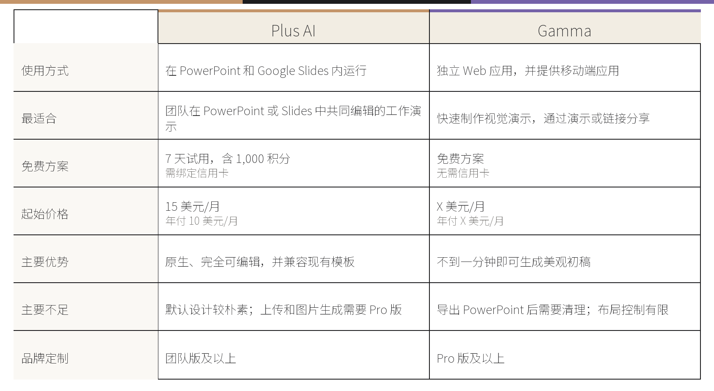

在各类 AI 工具普及之前，制作 PPT 时，梳理表达结构、逐页排版和调整样式都要靠纯手工完成，耗时费力。

当前，以 [Plus AI](https://plusai.com/) 和 Gamma 为代表的 AI 演示文稿生成工具，极大地简化了这一流程。只需把原始数据或参考链接输入给工具，AI 就能承担起提炼大纲、组织逻辑和板式布局的大部分繁重工作。

不过，这两款工具究竟哪一款更实用呢？

本文将详细梳理它们各自的工作机制、日常实际使用体验，并针对不同的业务需求提供针对性的选型建议。

### Plus AI 与 Gamma 的核心区别

两者最根本的区别，在于它们运行的载体与工作环境不同。

[**Plus AI**](https://plusai.com/) 是一款直接嵌入在 PowerPoint 和 Google Slides 内部的插件。你只需打开常规的演示文稿，调出侧边栏的 Plus AI 操作面板，它就能直接在当前文件中生成或修改幻灯片。


在制作演示文稿时，你无需在多个浏览器标签页之间来回切换。这也是选择它最具吸引力的一点：界面直接依托于你熟悉的办公软件，几乎没有任何上手学习成本。

相比之下，Gamma 是一个完全独立的 Web 原生应用。内容创建、编辑排版乃至现场演示，全都在 Gamma 网页端完成；只有在需要本地文件时，才通过链接分享或导出为 PowerPoint、PDF 及 Google Slides 格式。


因此，两者的选型逻辑非常清晰：如果你的团队深度依赖 PowerPoint 或 Google Slides 协作，且要求产出的演示文稿在这些工具中保持原生、无损的可编辑性，Plus AI 是更稳妥的选择。

而如果你更青睐类似 ChatGPT 的对话式生成体验，或者希望最终的呈现效果具备网页般的交互体验与现代排版质感，Gamma 则更加合适。

### Plus AI：核心功能与亮点

[Plus AI](https://plusai.com/) 的创始团队拥有前管理咨询顾问、设计师和工程师的背景，这种基因在产品中表现得很明显：整套工具的设计理念完全契合职场人士日常制作商业演示文稿的真实习惯。

以 Google Slides 为例，你可以直接在插件市场中安装它。


安装插件后，幻灯片侧边栏会自动打开辅助操作面板。创建新的演示文稿时，只需点击顶部菜单栏的“扩展程序”（Extensions），在“Plus AI for Google Slides”菜单下选择“New presentation with Plus AI”即可启动。


进入演示文稿生成面板后，你会看到多个可配置的参数选项。你可以根据主题从零开始生成，也可以直接选用现成的模板。


以制作一份月度财务报告的演示文稿为例。点击“Use a prompt”按钮，即可直接粘贴或输入具体的财务数据；如果手头已有现成的 PDF 或 Word（Doc）文档，也可以直接上传作为数据源。


这里使用的完整输入提示词示例如下：

```text
MONTHLY FINANCIAL REPORT – March 2026
Company: Horizon Tech Solutions
Reporting Period: March 2026
Currency: USD

Financial Overview
The company recorded a net profit this month, supported by strong revenue growth and controlled operating expenses. Overall financial performance remained stable and aligned with quarterly targets.

Income Summary
Total revenue for the month was $1,480,000, representing an 11% increase compared to the previous month. Cost of goods sold totaled $620,000, resulting in a gross profit of $860,000 and a gross margin of 58%.

Operating Expenses
Operating expenses amounted to $610,000. Key expense drivers included employee salaries, cloud infrastructure costs, and marketing spend tied to customer acquisition campaigns.

Net Result
After operating expenses, the company achieved an operating income of $250,000. Taxes and miscellaneous expenses totaled $70,000, leading to a net income of $180,000 for the month.

Cash Flow
Operating cash flow remained positive at $210,000. Capital expenditures were limited to routine software and hardware upgrades, ensuring healthy cash reserves.

Balance Sheet Highlights
• Cash and cash equivalents: $2.3M
• Accounts receivable: $420,000
• Total assets: $4.8M
• Total liabilities: $2.1M

Key Financial Insights
• Profit margins improved due to better cost control
• Marketing spend showed a positive return on investment
• Cash position remains strong, supporting near-term growth initiatives

Outlook for Next Month
Revenue is expected to grow moderately, with expenses remaining stable. Focus will remain on maintaining profitability while supporting strategic investments.
```

接下来可以按需微调生成参数，例如幻灯片篇幅页数、模板设计风格以及文本的叙述语调（Tone）。确认无误后点击生成按钮，稍候即可生成完整的演示文稿。

以下是生成的大纲与初稿效果示例：


在生成最终幻灯片之前，Plus AI 会先提供一份完整的大纲。这一步非常关键：它让你在正式排版前就能全面审视整份演示文稿的逻辑骨架。你可以直接修改各页标题、调整章节叙事顺序，确保表达逻辑符合预期。在大纲确认后，AI 才会直接在当前文档的画布上生成具体幻灯片。

最终生成的幻灯片效果如下：


由于 Plus AI 原生运行在 Google Slides 和 PowerPoint 内部，最终生成的产物就是一份完全标准的演示文稿文件。其中的每个文本框、数据块和图片都保持独立且完全可编辑。即使接收文件的同事没有安装 Plus AI 插件，也能照常打开并随意修改。

此外，Plus AI 采用了自研的 Open XML 渲染器来构建 PPTX 文件。因此在 PowerPoint 中打开时，不会出现常见的排版错位，也不会粗暴地把复杂内容拼成一张张无法二次编辑的静态图片。

在团队版（Team Plan）中，你可以配置企业专属的 Logo、品牌色和字体规范。企业级用户更可以进一步直接导入公司现有的母版模板（Slide Masters），让 AI 基于设计团队已审核通过的标准模板来生成幻灯片。

### Gamma：核心功能与亮点

[Gamma](https://gamma.app/products/presentations) 则采取了截然不同的产品路径。它不再使用传统的固定比例幻灯片，而是基于**卡片**来构建演示内容。这些卡片具备高度的自适应弹性，能够根据容纳的内容量自动延伸或折叠。

据官方统计，全球用户已借助 Gamma 创建了超过 2.5 亿份演示文稿、网页、社交媒体图文以及各类文档。

上手 Gamma 几乎不需要准备时间。你可以输入一句提示词、粘贴一段大纲，或者直接上传 Word、PDF 及 Google Docs 文件。选定主题风格后，Gamma 会自动生成文案、规划排版布局并配上恰当的插图。

Gamma 的编辑体验更贴近 Notion，而非传统的 PowerPoint。内容以模块的形式组织，支持自由拖拽；你可以随时呼出内置的 AI 助手，针对单张卡片重写文本、切换布局或重新生成配图。如果对整体视觉不满意，只需一键就能为整套演示文稿更换全新的设计主题。

制作完成后，你既可以直接在 Gamma 网页端全屏演示，也可以发送在线链接供他人交互式浏览；如需离线交付，还支持导出为 PowerPoint、PDF、PNG 或 Google Slides。

更值得一提的是，Gamma 还能将同一份内容无缝转换为网页、长文档或社交媒体图文，这是专注幻灯片场景的 Plus AI 所不具备的多形态能力。

在更高阶的付费方案中，Gamma 还提供了自定义品牌资产、访客阅读行为深度分析、绑定独立域名以及开放 API 接入等企业级功能。

### Plus AI 与 Gamma 综合对比

以下是两个平台的核心维度对比概览：



不过，单纯罗列功能参数往往只能反映表面差异。在实际工作场景中，特别是在面临交付时间节点的压力下，工具的具体操作手感和落地体验才是决定效率的关键。

### 基于提示词生成演示文稿

在生成速度上，Gamma 明显更胜一筹。输入提示词并选定主题后，通常不到一分钟，系统就能交付一份完整的演示文稿，且几乎每张卡片都自动配齐了契合主题的图片、图标与排版布局。

初次体验时，其成品的完整度确实令人印象深刻。

生成过程界面效果如下：


AI 生成的内容会被组织在具备流动性的弹性模块中，并根据文本量自动调整容器尺寸。你无需手动调整字号大小，也不必担心文字溢出文本框，其内置的“智能幻灯片”（Smart Slides）机制会自动处理好所有版式细节。


不过，Gamma 的潜在短板在于文案生成。它的文本往往偏向冗长，加之卡片支持自适应延伸，AI 不会主动克制篇幅去精简文字。这导致某些卡片堆叠了两到三个长段落，而按照标准幻灯片的阅读习惯，这里本应只放一个核心标题搭配几行精炼要点。

此外，当信息存在空白时，Gamma 有时会自动虚构填入一些你从未提供过的具体数字。因此在正式演示前，务必逐张卡片核对文案与数据的准确性。

相比之下，Plus AI 的生成耗时稍长，通常需要一到两分钟。在正式绘制幻灯片前，它会先展示每页的大纲，允许你在这一阶段自由重排顺序、修改标题或删除页面。这种交互非常实用，在页面尚未成型前调整整体框架，成本远比生成后再逐页修改低得多。

Plus AI 最终呈现的文稿风格更偏向典型的商业严肃风。它采用规范的设计模板，字体统一、间距规整，并在项目符号旁搭配了协调的图标。

与 Gamma 相比，它的排版结构更加紧凑，通常由精炼的标题搭配三到四个核心论点组成；不过整体视觉可能略显朴素，尤其是在未开启 AI 图片生成选项时。

### 初稿生成后的二次编辑与润色

没有任何一款 AI 工具能一次性生成完美无缺的演示文稿，因此初稿完成后的编辑调整，往往才是耗费时间精力最多的环节。

对我而言，Plus AI 最具价值的功能是它的“重混”（Remix）和“重写”（Rewrite）功能。你只需选中某一页幻灯片，挑选一个新版式，Plus AI 就能在数秒内单独重构该页，完全不会影响其他页面的内容和结构。

如果某页幻灯片充斥着密集的大段文本，“Remix”可以将其快速转化为时间轴结构或带有图标的多列分栏；而“Rewrite”则能在保持现有排版不变的前提下，进一步提炼和精简文字表达。

Gamma 的内置 AI 助手在交互上则更加灵活。你可以直接用自然语言向它提出几乎任何修改要求，比如“将这段内容改写得更精炼”或“转换成时间线形式”，它通常都能准确理解并执行。

此外，一键为整套文稿切换全局主题与设计风格，也是传统 PowerPoint 难以比拟的高效体验。

不过，Gamma 在精细控制层面存在明显的局限。受限于基于模块（Block）的排版逻辑，它无法像 PowerPoint 那样支持自由拖拽和像素级微调。

如果你想将某个图标向左轻微平移，或者单独调整某张图片的尺寸，通常只能反复切换不同的预设布局，直到挑出最接近期望的效果。

## Plus AI 与 Gamma：逐项核心特性深度对比

### 视觉设计质量（Design Quality）

第一印象往往至关重要，尤其是在向客户提案或向投资人汇报的关键场合。

- **Plus AI**：内置模板干净且专业，字体层级和版面间距规范高度统一，视觉风格非常契合专业管理咨询公司的汇报标准。但整体设计取向较为保守，如果在生成时未搭配插图，部分文字页可能会略显单调朴素。
- **Gamma**：主题设计现代且富有视觉张力，且无需额外提示，系统就会主动配置风格相符的图片并应用多样化的卡片布局。单看生成的初稿效果，多数人很容易误以为这是由专业设计师精心排版的作品。

**胜出方：Gamma**。在无需人工额外干预的前提下，Gamma 产出的初稿视觉质感明显更胜一筹。

### 可编辑性与文件兼容度（Editability and File Compatibility）

这个维度的对比，直接决定了当 AI 完成初步生成后，你或团队成员在后续协作调整中的实际工作量。

- **Plus AI**：所有生成的元素都完全原生于 PowerPoint 和 Google Slides。图表是可编辑的真实数据图表，文本框是标准的独立文本框，能够与你现有的任何公司模板、母版规范或第三方插件无缝兼容。
- **Gamma**：虽然支持导出为 PowerPoint 和 Google Slides，但这一过程本质上是将 Gamma 的 Web 卡片格式进行格式转译。在转换过程中，常常会出现文本框错位、默认字体被替代、过长的卡片在不合理的位置被生硬分页等问题。如果直接在 Gamma 网页端在线演示，这完全不是负担；但若团队必须以本地 PPT 文件协同交付，导出后往往需要不少手动修复工作。

**胜出方：Plus AI**。如果演示文稿最终必须在 PowerPoint 或 Google Slides 中归档与协作，直接在原生文件内部操作能够省去大量后期格式调整的时间。

### AI 编辑与二次调整能力（AI Editing Tools）

生成初稿往往只完成了工作的一半，日常大部分时间实际上都花在初稿出来后的局部修改与优化上。

- **Plus AI**：“重混”（Remix）和“重写”（Rewrite）功能响应迅速且定位精准。你可以明确指定需要修改的具体单页或局部文字，Plus AI 只会调整目标区域，绝不影响其他部分。此外，对于每周需要制作类似汇报的用户，团队版中的自定义指令与预设保存功能可以进一步固化高效的工作流。
- **Gamma**：内置的 AI 助手支持用自然语言处理几乎任何改动诉求，并且支持一键切换全局设计风格与主题。不过，在元素位置和尺寸的精细控制上相对受限。

**胜出方：平局（各有侧重）**。Plus AI 更擅长局部单页的高精度微调，而 Gamma 则在全局结构与整体风格的宏观调整上效率更高。

### 品牌定制与模板支持（Branding and Templates）

如果所在企业拥有严格的品牌视觉规范（VI Guidelines），这个维度往往是极为关键的考量指标。

- **Plus AI**：团队版支持配置企业 Logo、品牌配色与标准字体；而在企业版（Enterprise）中，Plus AI 能够直接读取并调用公司现有的 PPT 官方母版（Slide Masters）与设计资产库来构建幻灯片。
- **Gamma**：Pro 专业版用户可以创建自定义品牌主题，包含专属配色、字体与 Logo。在 Gamma 原生演示文稿中表现出色，但它本质上是一套独立的 Gamma 主题规范，与企业内部现有的官方 PowerPoint 模板是相互割裂的。

**胜出方：Plus AI**。能够直接套用企业现有的官方母版模板，极大地省去了后续与设计团队反复对齐和修图的沟通成本。

### 总结与选型建议

综合来看，面对绝大多数日常职场汇报，我更倾向于推荐 Plus AI，因为大多数商业演示文稿最终都需要在 PowerPoint 或 Google Slides 中归档与协同流转。

而如果追求极致的出稿速度、现代化的视觉质感，且你可以完全掌控演示与交付的方式（例如直接通过网页链接展示），Gamma 则是更理想的选择。

**更适合选择 Plus AI 的场景：**

- **咨询顾问与外包团队**：交付给客户的演示文稿必须能在 PowerPoint 中完美打开，且需要严格贴合客户提供的母版模板。
- **企业内部协作团队**：演示文稿需要在多位团队成员之间流转修改，大家都习惯在 Google Slides 或 PowerPoint 原生环境中编辑。
- **数据密集的业务汇报**：文稿中包含大量数据图表，且后续季度需要直接点击图表更新底层数据。

**更适合选择 Gamma 的场景：**

- **创业者与独立自由职业者**：需要快速产出一份视觉质感出色、排版惊艳的商业计划书或业务提案，且通过在线链接即可直接向对方分享展示。
- **内容创作者与教育培训者**：希望将同一套核心内容同时分发为演示文稿、独立网页以及社交媒体图文等多种形态。
- **低频演示文稿制作者**：每月仅需制作少量演示文稿，希望依靠免费或低成本方案快速搞定初稿。

## 产品体验入口
* Plus AI：https://plusai.com/
* Gamma：https://gamma.app


