> **太长不看（TL;DR）**：
> 大模型微调看似术语繁杂，底层其实只围绕一个问题——**你想改动模型的多少参数，又该如何高性价比地存下这些改动？**
> - **全量微调（Full Fine-Tuning）**：放开所有权重从头改，上限最高、任务跨度大时最彻底，但显存开销极大，容易遗忘旧知识且每套任务都得存完整大模型。
> - **PEFT**：冻结绝大部分权重，只动极小比例的关键参数，避开硬件瓶颈与灾难性遗忘。
> - **LoRA**：冻结原权重 $W$，用低秩矩阵相乘（$BA$）拆解增量，把几十 GB 的微调模型压缩成几 MB 的即插即用适配器。
> - **QLoRA**：把冻结基座量化压缩到 4-bit 节省显存，计算时逐层临时还原 16-bit，让大模型在消费级单卡/笔记本显卡上也能跑微调。
> - **DoRA**：把权重拆解为“大小”与“方向”，只用 LoRA 调方向并归一化，解决了 LoRA 大幅转弯时牵连破坏权重大小的耦合问题，效果逼近全量微调。
> - **QDoRA**：将 4-bit 量化基座与 DoRA 适配器结合，兼得极低显存与更高精度。
> 
> **选型建议**：写提示词优先；补业务事实用 RAG；定风格格式与规范选微调。微调首选 **LoRA**；硬件受限用 **QLoRA**；追求更高效果换 **DoRA/QDoRA**。

刚训练好的大语言模型，具备很强的通用知识，但它对你的公司一无所知，不清楚客服平时怎么跟客户沟通，也不懂你们的产品有哪些具体功能，更不知道哪些回答会带来合规或业务风险。

所谓微调（Fine-Tuning），本质上就是给模型灌输这种特定领域的知识和行为模式。

可一旦开始深入了解微调技术，各种术语便扑面而来：全量微调（Full Fine-Tuning）、PEFT、LoRA、QLoRA、DoRA、QDoRA……，这些概念常常被讲得像是完全不同的东西。但实际上，它们几乎都在围绕同一个核心问题展开：你打算改动模型的多少参数，又该多巧妙地去改动它？

本文从最基础的运行机制讲起，逐步拼出微调技术的全貌。我会从模型平时如何生成一个词，讲到如何在普通笔记本电脑的显卡上做微调。只要始终抓住这个核心问题：“我们到底动了模型的多少参数”，后面的各种方法自然就能顺畅地串联起来。

### 首先，模型究竟是如何回答你的？

在动手改动模型之前，有必要先看看它是怎么回答问题的。表面上看它像是在跟你自然对话，但在底层，它其实只是在以极快的速度循环执行三步：

第一步是**分词（Tokenization）**：模型会把输入的句子切成一个个片段（Token）。一个 Token 通常是一个词或者词的一部分，比如 “tokenization” 这个词本身就可能被拆成 “token” 和 “ization”。

第二步，模型结合上下文逐一理解这些 Token 的含义、语法和语气。

最后，它执行自己受训时唯一学会的事情：给出概率分布，预测下一个最可能出现的词。

*大模型回答你的过程，本质上是一个不断循环的三步操作：把文本切成 Token、结合上下文理解含义，再按概率推测下一个词。*

最后这一步是整套机制的关键。模型本身并没有现场去翻查资料，而是一刻不停地推测下一个词、再推测下一个词。我们在微调中所做的一切，说到底都是在轻微调整这些概率，让它推测出来的词更符合我们的预期。

### 模型的知识究竟从何而来？

这些推测概率并不是凭空产生的，它们来自**预训练（Pre-training）**。

简单来说，预训练就是让模型读完海量的文本（包括网页、图书、代码和百科等），并在这些文本上一遍又一遍地玩“猜下一个词”的游戏，重复几十亿甚至上万亿次。在这个过程中，模型内部的参数数值（Parameters，也叫权重 Weights）会逐渐稳定下来，变得能够准确猜词。这就是最基础的预训练。

但这通常还不够用。

未经额外处理的原始预训练模型只擅长顺着文本往下续写，天生并不会按指令老老实实答题。因此，我们还需要给它看大量“提问-回答”的样例，让它学会按照问题来给出解答，而不是漫无边际地自说自话。这一步就叫**指令微调（Instruction Tuning）**。

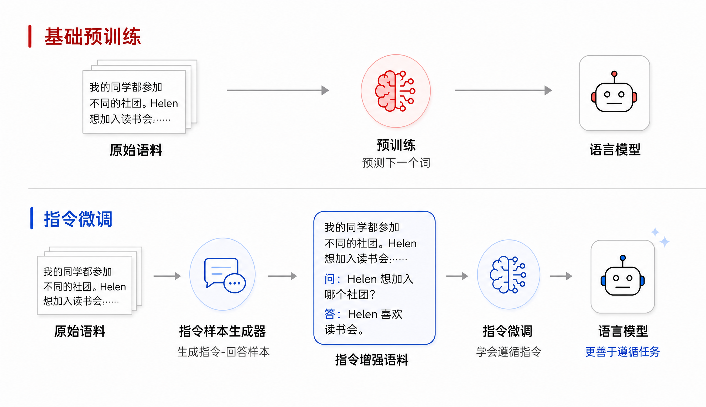

简而言之，预训练让模型通过猜词掌握了语言规律，而指令微调教会了它听懂并遵循人类的指令。

最终大家下载到的，正是这类“基座”模型：懂得多、底子好，但对你的具体业务全然陌生。

### 为什么光有预训练模型还远远不够？

一旦把这种通用模型直接放到实际业务中用，很快就会遇到四个明显的问题：

首先是**知识太泛**。它知道的都是大面上通用的常识，没有任何专门契合你业务的细节。其次是**内容完全是静态的**。它的知识停留在训练结束的那一天（即知识截止日期），之后发生的新事情它概不知晓。

再者是**完全不懂特定领域**。它不知道你们公司的内部流程、产品逻辑和常用的行业黑话。

最后是**容易产生幻觉**，即常见的一本正经地胡说八道。


这些并不是模型出故障了，而是“学遍了全网内容、却从未针对具体业务做过专门训练”必然会出现的状况。

so，我们该怎么解决这些问题？

### 改进模型的三种常见做法，微调处于什么位置？

要补齐通用模型与实际业务之间的差距，业内通常有三件工具。它们不是互相冲突的竞争关系，而是各自干不同的活：

第一种是**提示词工程（Prompt Engineering）**：直接通过写出更明确、结构更合理的提示词来引导模型，有时还会随附一两个例子作为参考（按提供例子的多少，分别叫零样本 Zero-shot、单样本 One-shot 或少样本 Few-shot）。这是尝试成本最低的方式，遇到问题时总该最先用它。

第二种是**检索增强生成（RAG, Retrieval-Augmented Generation）**：把专门的业务资料存放在一个独立的外部知识库里。当有人提问时，系统先去检索最相关的参考资料，把资料直接拼进提示词里一起交给模型，让它根据新鲜、确凿的事实来回答。当核心痛点是“模型缺少某些具体知识”时，RAG 是最管用的工具。

第三种才是**微调（Fine-Tuning）**：直接改动模型本身的参数，把特定的说话习惯、回答风格或严格格式直接刻进模型里。当痛点在于“说话语气、行文风格或输出格式”，也就是写再多提示词也很难稳定约束住的场景时，微调才是根本的解法。

一个实用的经验规则：**能写好提示词就先用提示词；模型缺具体事实时用 RAG；当你需要它长期保持某种稳定一致的行为表现时，再选择微调。**

### 那么，微调究竟是什么？

拿掉那些花哨的专业词汇，透过现象看本质，微调其实非常简单：找一个已经在全网数据上学完基础语言的基座模型，再用一份规模小得多、但全是你特定领域或业务的数据，继续训练它一阵子。模型不仅能保留原有的语言能力，还会顺应你的这批数据做出适应性调整。

*一句话概括：拿现成的通用基座模型，用你自己的专属数据接着训练，最终得到一个符合你特定需求的定制模型。*

原理仅此而已。后面大家争论的“全量微调还是 LoRA”，争的也只是同一件事：训练时你究竟打算让模型的哪些参数发生变化，以及用什么方式把这些变化存下来。

### 微调到底改变了什么？

平时大家说“微调”时，其实往往指向两种截然不同的目标，把它们区分开非常重要：

一种是**改变行为习惯**：比如调整它的说话语气、表达口吻、返回格式，以及照着规则做事的规矩。

另一种是**补充专业知识**：让它记住原本不知道的特定事实和业务术语。而在很多实际场景里，我们往往两者都想要。

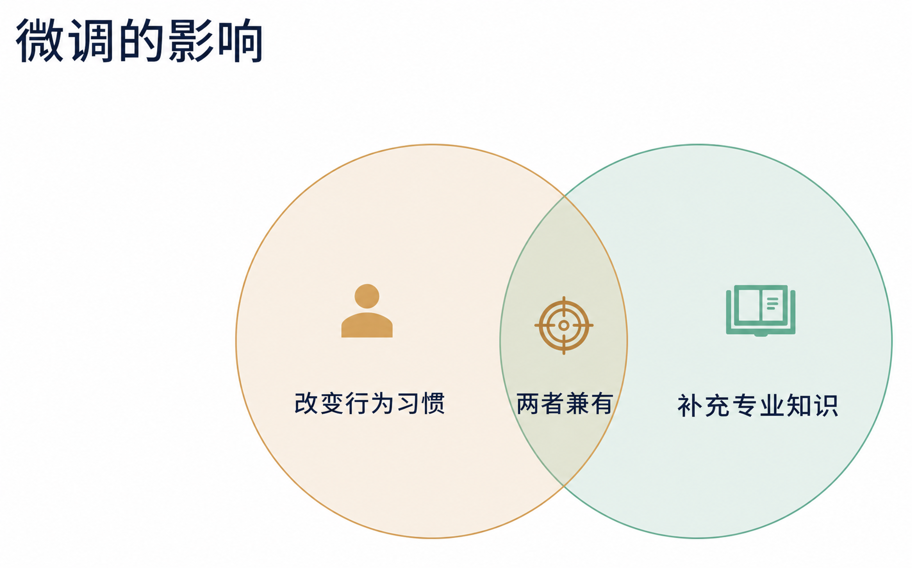

想清楚自己到底需要哪一种，能少走很多弯路，避免白白浪费训练算力和时间。如果只是想让模型知道一些最新事实，微调通常是最费劲、最不讨好的做法，用 RAG 会轻松得多；但如果你要的是模型说话做事的稳定性和规范度，微调就是最合适的手段。

### 什么时候该微调，什么时候不该？

关于要不要微调，其实不需要犹豫太久。只要观察几个信号，就能大致做出判断：

*决定启动微调的几个典型信号。*

当你反复精心写了提示词、却总是得不到稳定效果时；当你手里有一份稳定、不会天天变动的大批量专业知识时；以及你手里确实攒够了高质量的训练样例时，就适合考虑微调。

此外，当你需要极其独特的行文风格、基座模型在你的专业行业里错漏百出、或者你处在一个有着独立术语体系的小众行业时，微调通常都物有所值。

反过来，什么时候不该微调同样关键：如果改改提示词就能解决问题，就坚决不要微调；如果你的业务内容每天都在更新变动，直接去用检索（RAG）。微调是要付出训练和维护成本的，只有低成本方案都试过且不够用时，才值得做这笔投入。

### 方案 1：全量微调

最直接的微调方式就是**全量微调（Full Fine-Tuning）**；如果微调的目的是让模型听懂并执行各类任务，有时也叫指令微调。做法就如字面意思：接着已有的模型权重继续训练，把模型里的**每一个参数**全部放开更新，什么都不冻结。

当你的任务和基座模型之前学过的所有东西都差别极大时，全量微调是最好的选择，因为你给了模型完全的自由去彻底重组自己的参数。

但问题在于成本极高，而且这种成本很容易被人低估。想象一个数百亿参数的大模型：全量微调意味着要更新里面的所有参数；不仅如此，每为一个不同的任务或客户做一套微调，就得单独存一份完整的大模型。一份大模型就有几十 GB，三位客户就得存三份几十 GB 的大文件，这时线上甚至连一次请求都还没开始响应。

除了占用大量存储和计算资源外，全量微调还有几个广为人知的明显缺点：

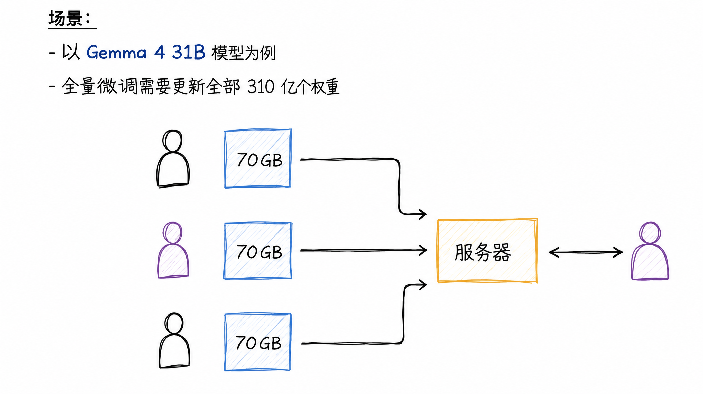

首先是**显存开销极大**，机器必须同时容纳并更新模型的所有参数、梯度和优化器状态。

其次是存在**灾难性遗忘（Catastrophic Forgetting）** 的风险，在教模型学习新任务的同时，容易抹掉它原本掌握的基础通用能力。

另外，它的计算成本也很高，如果手头数据量较少，还极易发生**过拟合**；对参数改动过大，还会削弱模型在其他下游任务上的综合表现。因此，我们自然会产生一个疑问：**真的有必要去动每一个参数吗？**

### 更聪明的思路：PEFT

在大多数情况下，答案都是“不需要”。这正是 **PEFT（Parameter-Efficient Fine-Tuning，参数高效微调）** 这一流派的核心思路。

与其更新整张庞大的神经网络，不如把绝大部分模型参数直接冻结住，只挑极小一部分参数来训练。模型还是原来的模型，但我们不再费劲去重装整台机器，而是挑出少数几个最关键的旋钮来微调。

*全量微调会更新每一个参数；而 PEFT 则冻结绝大部分结构，只训练极小比例的一小撮参数。*

这种做法一下子带来了三个明显的好处：它彻底避开了全量微调对硬件的严苛要求；训练时只碰模型的一小部分参数；而且因为大部分原始参数压根没动，模型几乎不会发生灾难性遗忘。

需要说明的是，PEFT 是一整套方法的统称，而不是某一种具体算法。常见的有 Adapter、Prompt Tuning、Prefix Tuning，以及本文后面重点要讲的主线：LoRA、QLoRA、DoRA 和 QDoRA。它们之间是一环扣一环递进发展的，我们按顺序挨个来看。

### LoRA：不改原始权重，只记录变化量

LoRA（Low-Rank Adaptation，低秩自适应）始于一个非常巧妙的思路转变：它不再直接去改动预训练权重，而是让原始权重原封不动，单独去学需要叠加的变化量。

你可以把模型原本的权重矩阵 $W$ 看作是被锁定的。LoRA 在它旁边额外并联了一个更新矩阵（记作 $\Delta W$）。在实际运行时，模型直接使用被冻结的原权重加上新学到的增量，也就是 $W + \Delta W$。你根本不需要去动原模型，只需要额外记下每次要加进去的变化量就行了。

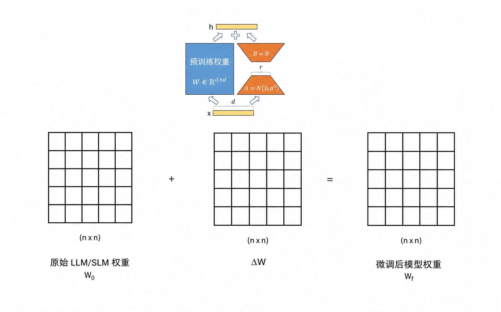

*LoRA 冻结了预训练权重 $W$，单独学习额外的更新部分。这个更新由两个小型矩阵 $A$ 和 $B$ 拼成，一开始把 $B$ 设为零，这样训练刚开始时完全不影响原有输出。*

至于它为什么能省下海量开销，关键就在这个技巧：更新量 $\Delta W$ 并没有存成一个完整的大矩阵，而是拆成了两个瘦长的小矩阵，通常叫 $A$ 和 $B$。它们中间共享一个非常小的维度（也就是秩，Rank，通常记作 $r$）。把一个高瘦矩阵和一个扁平矩阵相乘，算出来的矩阵形状和原来的 $\Delta W$ 一模一样，但你全程只需要保存和计算这两个小得多的矩阵。

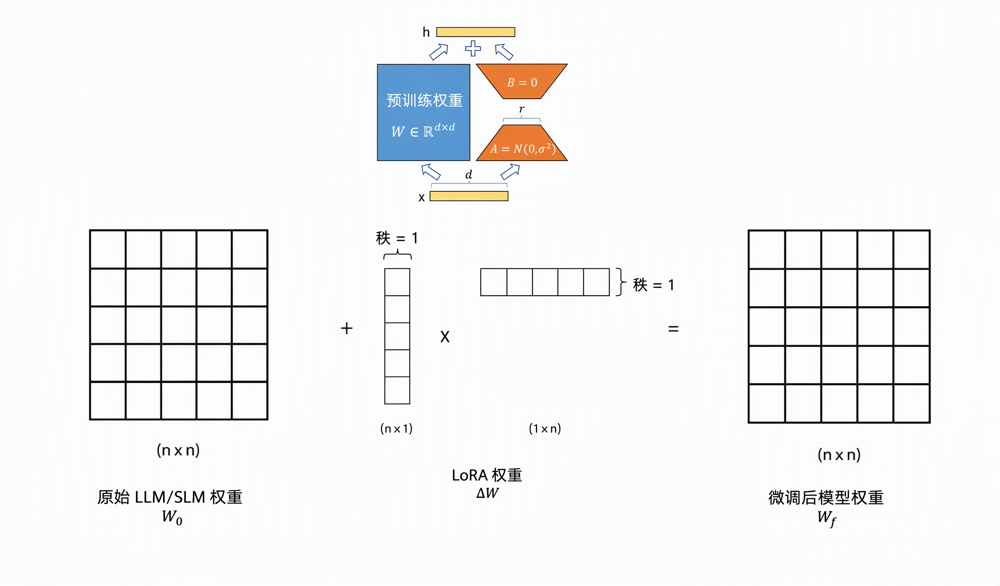

*全量更新需要算一个完整的 $n \times n$ 大矩阵；LoRA 则把它近似成高瘦矩阵（$n \times r$）和扁平矩阵（$r \times n$）相乘。只要秩 $r$ 取得很小，需要训练的参数量就只是原来的一小部分。*

这也是为什么 LoRA 适配器文件非常小，比起动不动就几十 GB 的基座模型，它通常只有几 MB。而且因为适配器本身是独立的小文件，你可以只在机器上常驻一份冻结好的基座模型，针对不同的业务随时挂载对应的适配器。

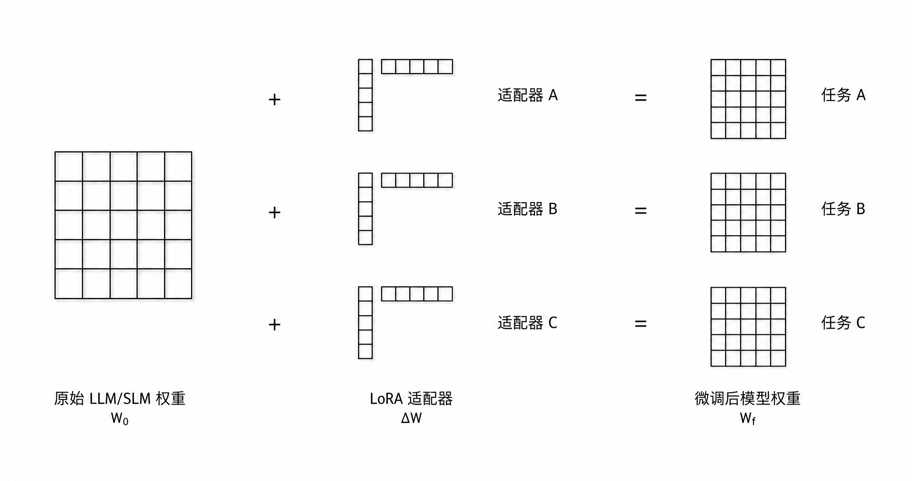
*一份冻结的基座模型，搭配多个小适配器：任务 A 挂载适配器 A，任务 B 挂载适配器 B，底层共享同一套沉重的基座。*

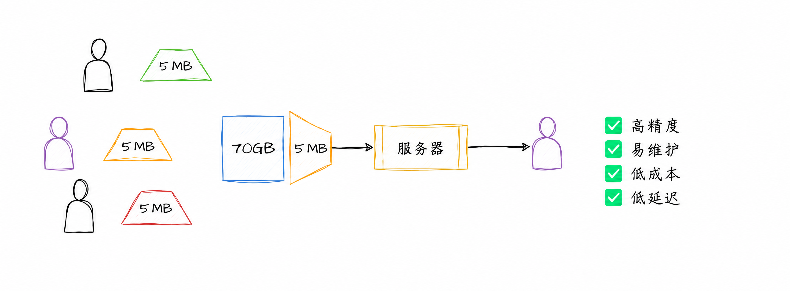

*工程落地的巨大优势：在同一个共享基座上挂上针对各任务的小适配器，既能保证效果，又好维护，成本低且响应快。*

如果用一句最直白的话来说明数学原理：模型的输出计算从原来单独依靠 $W$，变成了依靠 $W + BA$。庞大且冻结的原权重负责承担绝大部分繁重的基础计算，而小巧的矩阵对 $BA$ 专门负责承载你的个性化需求。

### QLoRA：先压缩基座，再用 LoRA

LoRA 已经帮我们免去了给每个任务单独存一份完整模型的麻烦。但在训练阶段，你依然得把整个基座模型完整塞进显存里，对于大模型来说，光是这一步就需要一张很贵的专业显卡。**QLoRA（Quantized LoRA，量化低秩自适应）** 解决的就是这个痛点，思路极其朴素：**先把基座压小，再在上面做 LoRA**。

所谓“量化（Quantization）”，其实就是用更少的信息位（Bit）去存数字。一般大模型都用 16 位浮点数（FP16/BF16）存权重；QLoRA 直接把冻结的基座模型压缩到 4 位（4-bit），体积大概缩减到原来的四分之一，然后再在上面训练普通的 LoRA 适配器。

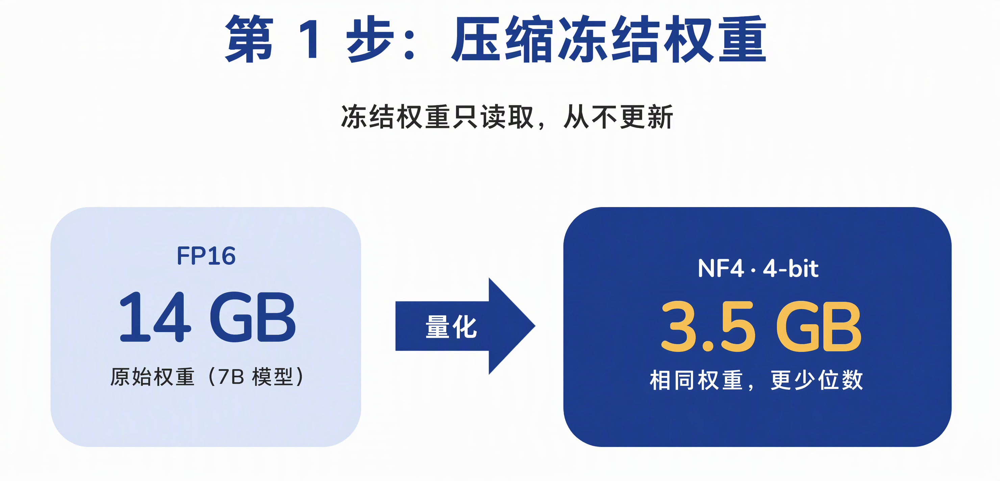

*第一步：把冻结的基座权重从 16 位压到 4 位。以 7B（70 亿参数）模型为例，权重占用的显存从约 14 GB 直接降到 3.5 GB 左右。因为这些权重训练时只用来读取、从不更新，所以压得再狠也很安全。*

更精巧的地方在于，它在算矩阵乘法时还不会把省下来的显存吐回去：4 位的权重平时在显存里始终保持压缩状态；只有当模型真正算到某一层时，才临时把这一层解压缩回 16 位（反量化 Dequantize），算完立刻把解压后的临时数据丢弃。这样显存里同一时间永远只有单层处于全精度。

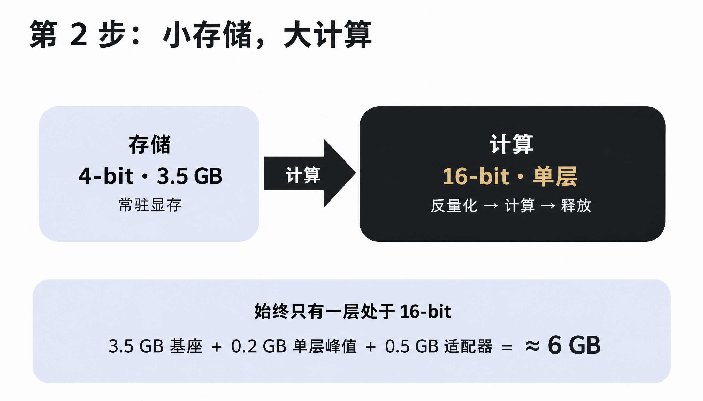

*第二步：平时只存压缩版，一次只算一层的全精度。把单层临时还原为 16 位，做完计算立刻释放，峰值显存直接压到 6 GB 左右，而不再是 20 GB 以上。*

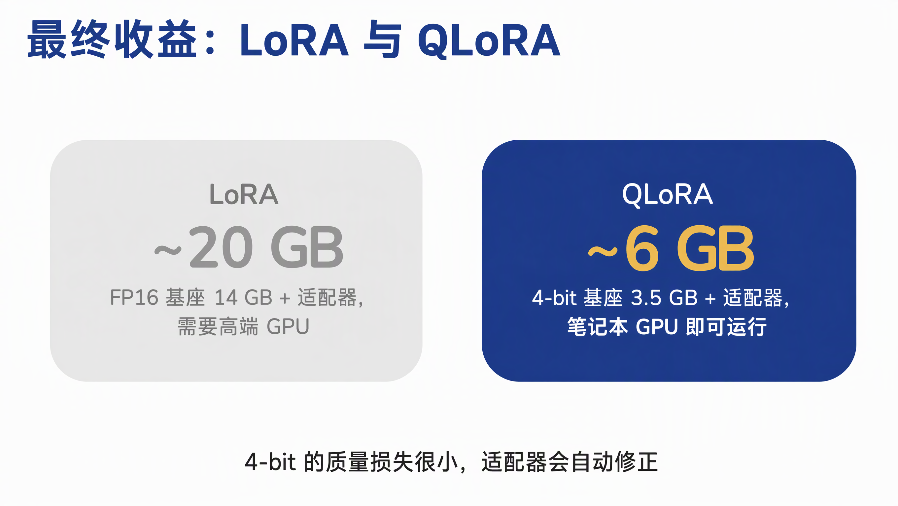

*最终收益：普通的 LoRA 依然带着 14 GB 的基座，必须依赖高端显卡；而 QLoRA 只需要 3.5 GB 的基座，笔记本电脑上的显卡就能直接跑起来。4 位量化损失的精度其实很小，而且训练中的适配器还会自动适应并填补这点误差。*

最后这点非常重要。很多人可能会以为压到 4 位会让模型表现大打折扣。但实际测试下来精度损失微乎其微，很大程度上是因为正在训练的适配器在迭代中自动修正了量化带来的偏差。

### 稍作展开：权重的大小与方向

在讲接下来的两个进阶方案 DoRA 和 QDoRA 之前，我们需要先弄明白关于权重的一个小概念。这步值得放慢节奏读懂，因为后面的原理全靠它支撑。

模型里的每个权重矩阵，本质上都可以看成由一组向量组成的。一个向量天生有两个互不干扰的属性：一个是**大小（幅值 Magnitude）**，也就是它的长短，代表着这个特征有多强、有多确定；另一个是**方向（Direction）**，也就是它指往哪边，代表着它到底在表达什么内容。

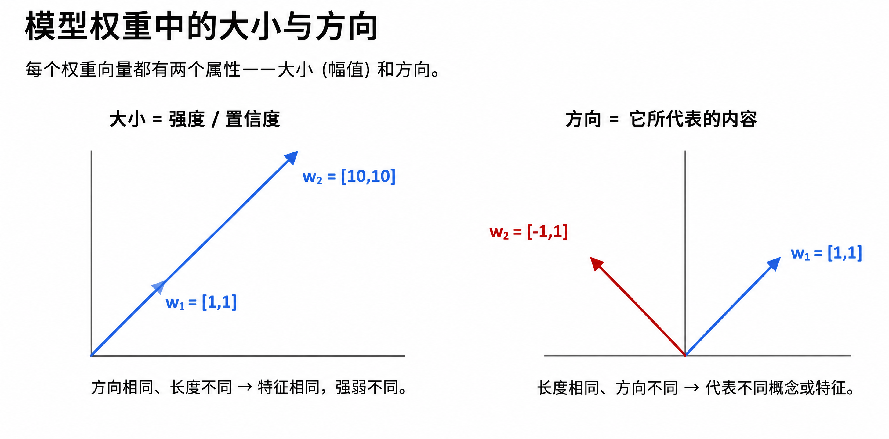

*权重向量的两个独立属性。方向一致但长度不同，说明表达的是同一个特征，只是强弱有别（左图）；长度一样但方向不同，说明表达的已经是完全不同的两个特征了（右图）。*

简单来说：改变权重的长度，是在把某个特征调大或者调小；而改变权重的方向，是在把特征换成另一个。这是两种完全不同的修改方式——而这两者的差别，正是 DoRA 诞生的原因。

### 为什么 LoRA 在“大幅转弯”时表现吃力？DoRA 如何解决

这正是 LoRA 露出短板的地方。全量微调可以完全独立地分别改动权重的方向和大小，因为它可以自由挪动每一个参数。如果它想把某个权重转到一个新方向、同时保持原来的长度不变，直接调就行。

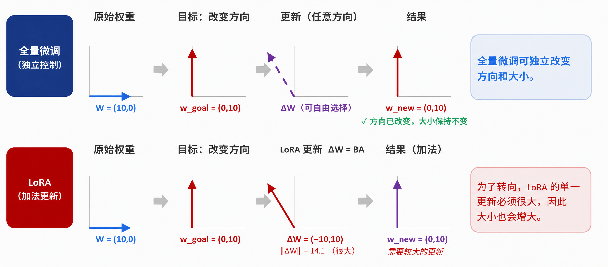

*全量微调（上方）可以在改变方向的同时保持原有长度，把方向和大小分开调；而 LoRA（下方）只有一个加法式的增量项，要把方向大幅转过去，势必会顺带着把原本的长度也撑大。*

相比之下，LoRA 手里只有一个杠杆：就是一个单独的加法更新项（也就是前面说的矩阵对 $BA$）。这意味着它必须用这一个增量项，同时把方向的改变和大小的改变都担起来，两者被硬生生捆绑在了一起。

如果你想让特征的方向发生较大幅度的改变，LoRA 唯一的办法就是把这个增量项做得很长；但这会带来一个副作用：就算你根本不想改变特征的大小，它的长度也会被连带着拉大。

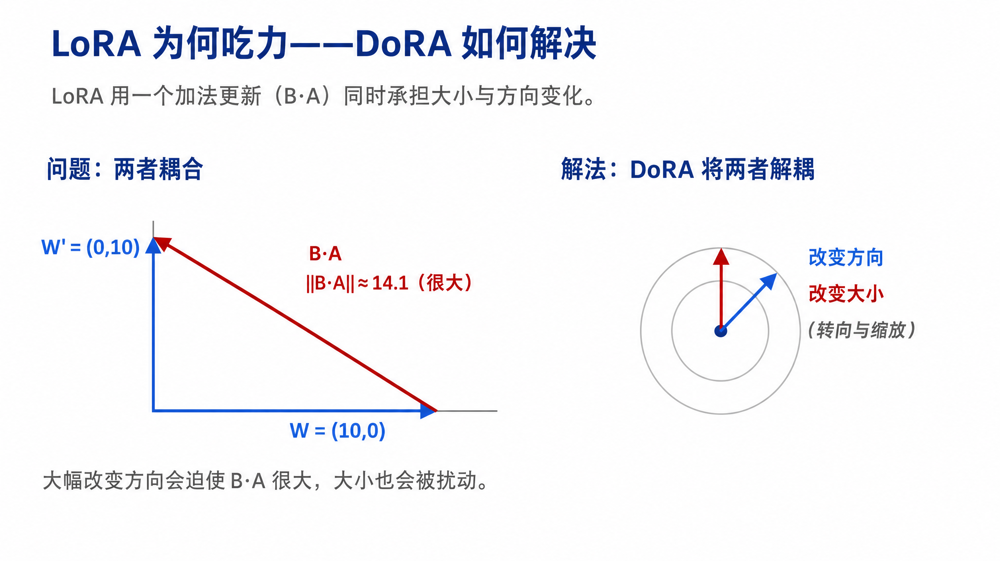

*捆绑问题：单靠一个加法向量把 $W$ 偏转至新方向，往往不得不把这个向量做得很长，从而打破了原本的大小。DoRA 的解法是将这两项任务拆解开来：调整方向归调整方向，缩放大小归缩放大小。*

**DoRA（Weight-Decomposed Low-Rank Adaptation，权重分解低秩自适应）** 的解法非常巧妙：在动权重之前，先把权重拆成这两个属性。它把大小单独拿出来作为一个可训练的数值（$m$），把方向作为另一个分量；然后只用 LoRA 来调整方向，并在算完后做一次归一化（Normalize），确保这次微调只纯粹地改变方向，绝不夹带任何大小变化。

最后，再把两者乘回去。这个过程用公式写出来就是：$W' = m \times \text{normalized}(V + B \cdot A)$。

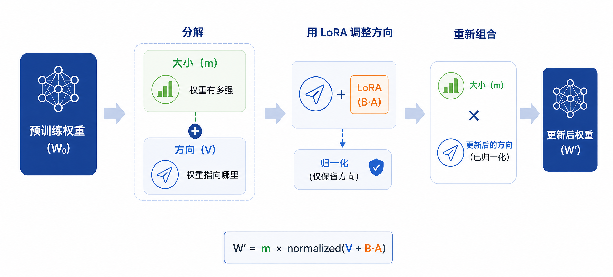

*DoRA 把每个权重拆成大小和方向，只用 LoRA 去调方向（重新归一化保持纯粹的转向），然后再把训练后的大小乘回来。方向和大小分开训练，达到了类似全量微调的效果。*

这样最终做出来的模型，在生成质量上更接近全量微调的高水准，同时又跟 LoRA 一样只需要训练极少量的参数。因为方向的改变再也不用跟大小相互牵制，特征方向的调整更加纯粹、不受干扰。

### QDoRA：在 4 位显存预算下运行 DoRA

理解了 DoRA 之后，QDoRA 的逻辑就不言自明了。还记得 QLoRA 的思路吗？就是“先把基座量化，再套上 LoRA”；QDoRA 也是同样的思路，只是把后面的适配器换成了表现更好的 DoRA：把基座模型压缩到 4 位并冻结住，然后再在上面训练一个 DoRA 适配器（独立的大小参数加上调方向的 LoRA 项）。

*QDoRA 本质上就是把 QLoRA 里的普通 LoRA 换成了 DoRA。既保留了 QLoRA 4 位量化的低显存优势，又拿到了 DoRA 的高精度。*

这样一来，你就能同时获得 4 位量化极省显存的好处，以及 DoRA 带来的更好效果。它是这组方案里最新提出的一个，目前相关的工具生态还在逐步成熟中；但核心逻辑非常纯粹，就是把前面讲清楚的两个思路有机结合在了一起。

### 总结与全景对比

跳出细节退一步看，这一整套微调技术其实整齐地排布在同一条坐标轴上，在显存占用、模型精度与生态成熟度之间做取舍。

在实际工程落地中，可以按如下思路做选择：**全量微调**效果最好但太重，通常没必要选；**LoRA** 是最理性的默认选项：速度快、成本低、体积小；**QLoRA** 适合手头显卡有限但又想调大模型的时候。

而当你需要 LoRA 的轻快，但又想要更接近全量微调的高质量时，**DoRA** 值得一试；最后，**QDoRA** 则是把 DoRA 的高效果和 4 位量化的低显存结合在一起，适合预算和质量要求都很严苛的场合。

### 核心代码实现

在代码层面，这套流程写起来其实非常简单。借助 Hugging Face 的 `peft` 库，几行代码就能把一个普通基座模型改造成支持 LoRA 的微调模型：先加载模型，在配置对象里填上适配器参数（比如低秩维度 $r$、要挂在哪些层上等），最后把模型包一层即可。

```python
from transformers import AutoModelForCausalLM, AutoTokenizer
from peft import LoraConfig, get_peft_model

# 1. 加载基座模型与分词器
model = AutoModelForCausalLM.from_pretrained("google/gemma-2b-it")
tokenizer = AutoTokenizer.from_pretrained("google/gemma-2b-it")

# 2. 配置 LoRA 适配器参数
lora_config = LoraConfig(
    r=16,                                 # 权重更新的秩（Rank）
    lora_alpha=32,                        # 缩放系数
    target_modules=["q_proj", "v_proj"],  # 指定挂载适配器的具体网络层
    lora_dropout=0.05,
    bias="none",
    task_type="CAUSAL_LM",
)

# 3. 包装模型：此时除适配器外，其余全部原始参数均被自动冻结
model = get_peft_model(model, lora_config)
```

代码里的 `r=16` 就是前面提到的低秩维度，`target_modules` 是让你指定在模型的哪几层挂上适配器。除了这部分，模型内部的所有其他参数都会保持冻结。如果要切到 QLoRA，只要在这一步之前以 4 位量化的格式加载基座模型即可；如果要切到 DoRA，也只需要在同一个配置项里改动对应的开关。

### 最佳实践与避坑指南

无论你选哪一种微调方法，以下几个习惯基本就决定了这次训练是否能成功：

最重要的毫无疑问是**数据质量和数量**。一份量不大、但是清洗干净、标注严谨的数据集，效果能轻松碾压海量杂乱无序的劣质数据。其次是**超参数调优**（比如学习率和 LoRA 的秩的大小），这是决定训练结果是平平无奇还是表现优异的关键。

此外，**训练过程中要持续做评估**，而不要等到全跑完了才看一眼，这样才能随时观察模型是在好转还是在跑偏，方便中途调整。

微调时最容易踩坑的通常有这四类问题，只要知道名字和原理，提前防范并不难：

- **过拟合（Overfitting）**：模型死记硬背了训练集里的具体样例，没有真正学会规律；在训练数据上表现非常好，换一批新数据就露馅。
- **欠拟合（Underfitting）**：正好相反，训练的轮次不够，或者数据里的有效信号太弱，模型根本就没学会这项任务。
- **灾难性遗忘（Catastrophic Forgetting）**：正如前面反复提到的，学了新东西，忘了旧常识（这也是为什么冻结大部分参数的 PEFT 方案在这里更安全）。
- **数据泄露（Data Leakage）**：评测集或测试集里的内容不小心混进了训练集，算出来看似满分，实际上没有任何参考价值。

### 总结

到这里，整个微调技术的全貌就非常清晰了。回过头来看，我们讲到的每一种方法，其实都在回答开篇提出的同一个问题：**你打算动模型的多少参数，又该如何巧妙地把这些改动存下来？**

全量微调把所有参数全改一遍；LoRA 只改额外附加的一小片参数；QLoRA 在此之前先把底座压缩变小；DoRA 更聪明地控制了这片参数应该怎么变动；而 QDoRA 则是在 4 位的显存预算下，把这一切全做到了。

虽然名词众多，但大体路径其实一脉相承，抓住本质就不会迷惑。


